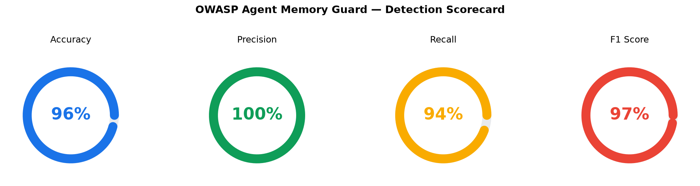
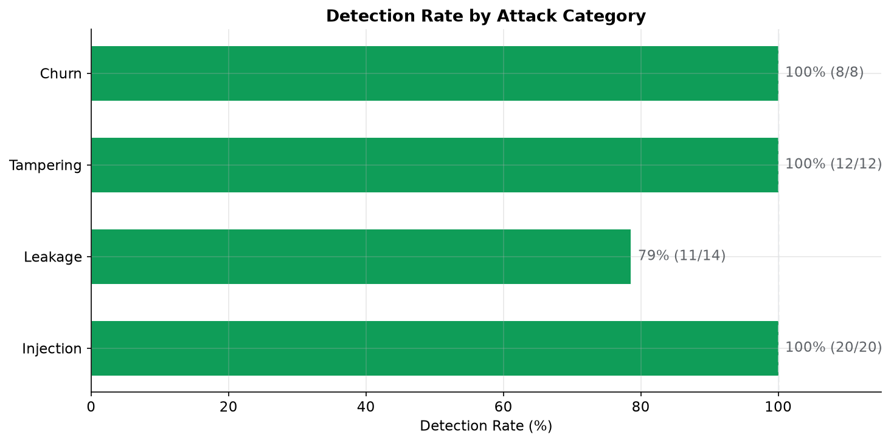
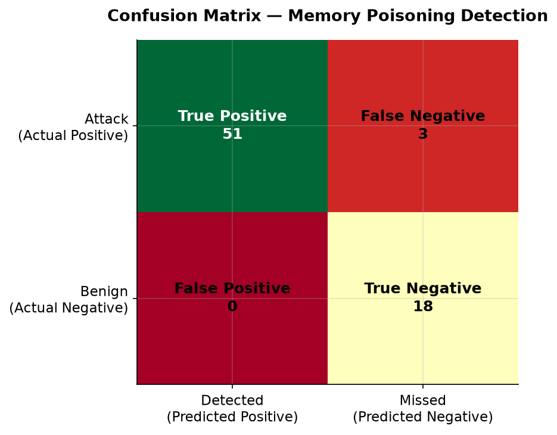
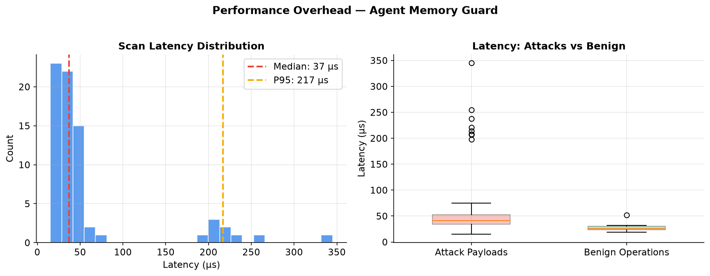
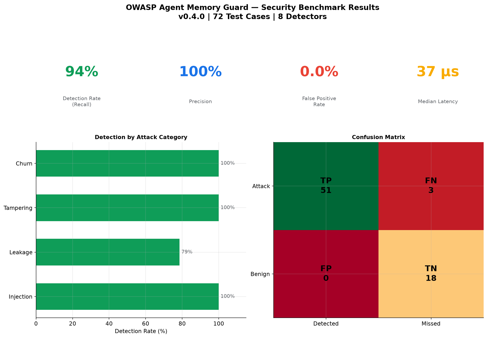

# OWASP Agent Memory Guard — Security Benchmark Report

**Version**: 0.4.0
**Test Cases**: 72
**Date**: 2026-10-27
**Python**: 3.13.5

---

## Executive Summary

With this benchmark policy and opt-in detector configuration, Agent Memory Guard detected **94.4%** of attack cases with **100.0% precision** across 72 labeled test cases; median write latency was **37 µs** in this local run.

| Metric | Value |
|--------|-------|
| **Accuracy** | 95.8% |
| **Precision** | 100.0% |
| **Recall (Detection Rate)** | 94.4% |
| **F1 Score** | 0.971 |
| **False Positive Rate** | 0.0% |
| **False Negative Rate** | 5.6% |
| **True Positives (TP)** | 51 |
| **True Negatives (TN)** | 18 |
| **False Positives (FP)** | 0 |
| **False Negatives (FN)** | 3 |

### Confusion Matrix

| Actual \ Predicted | Detected (Positive) | Allowed (Negative) |
|---|---|---|
| **Attack (Actual Positive)** | True Positive (TP): **51** | False Negative (FN): **3** |
| **Benign (Actual Negative)** | False Positive (FP): **0** | True Negative (TN): **18** |

---

## Detection by Attack Category

| Category | Detection Rate | Detected | Missed | Total |
|----------|---------------|----------|--------|-------|
| Injection | 100% | 20 | 0 | 20 |
| Leakage | 79% | 11 | 3 | 14 |
| Tampering | 100% | 12 | 0 | 12 |
| Churn | 100% | 8 | 0 | 8 |

### False Positive Analysis (Benign Operations)

| Metric | Value |
|--------|-------|
| Benign samples tested | 18 |
| Correctly allowed (TN) | 18 |
| Incorrectly flagged (FP) | 0 |
| False positive rate | 0.0% |

---

## Configuration Coverage

The headline figures above are measured with opt-in detectors enabled. A plain `MemoryGuard()` does not load them, so the same corpus scores differently out of the box. Both runs use the identical corpus and policy; only the detector set differs.

| Configuration | Detectors | Recall | Precision | FP rate | Missed |
|---------------|-----------|--------|-----------|---------|--------|
| Default suite (out of the box) | 7 | 85.2% | 100.0% | 0.0% | 8 |
| Benchmarked configuration | 8 | 94.4% | 100.0% | 0.0% | 3 |

**Opt-in detectors enabled here**: `memory_persistence_injection`

Per-category detection, default suite vs benchmarked configuration:

| Category | Default suite | Benchmarked |
|----------|---------------|-------------|
| Injection | 15/20 | 20/20 |
| Leakage | 11/14 | 11/14 |
| Tampering | 12/12 | 12/12 |
| Churn | 8/8 | 8/8 |

---

## Performance Overhead

| Metric | Value |
|--------|-------|
| **Median latency** | 37 µs |
| **Mean latency** | 60 µs |
| **P95 latency** | 217 µs |
| **P99 latency** | 281 µs |
| **Max latency** | 345 µs |

This local, synthetic measurement is not a general latency guarantee for production agent operations.

### Store Backend Overhead Measurements

**Redis Backend Status**: Redis backend (fakeredis in-process)

| Policy | Size | Operation | InMemoryStore (µs) | RedisMemoryStore (µs) | Overhead |
|--------|------|-----------|--------------------|-----------------------|----------|
| 1-rule | 100b | read | 18.8 | 96.3 | 5.1x |
| 1-rule | 100b | write | 19.0 | 48.7 | 2.6x |
| 1-rule | 100b | snapshot | 9.8 | 97.0 | 9.8x |
| 1-rule | 100b | rollback | 6.2 | 111.1 | 17.9x |
| 1-rule | 1kb | read | 150.2 | 220.2 | 1.5x |
| 1-rule | 1kb | write | 150.7 | 175.4 | 1.2x |
| 1-rule | 1kb | snapshot | 12.3 | 96.8 | 7.8x |
| 1-rule | 1kb | rollback | 6.1 | 114.6 | 18.8x |
| 1-rule | 10kb | read | 1537.5 | 1488.3 | 1.0x |
| 1-rule | 10kb | write | 1419.8 | 1506.1 | 1.1x |
| 1-rule | 10kb | snapshot | 36.6 | 139.2 | 3.8x |
| 1-rule | 10kb | rollback | 6.2 | 144.6 | 23.4x |
| 1-rule | 100kb | read | 13998.6 | 14110.2 | 1.0x |
| 1-rule | 100kb | write | 13811.7 | 14016.1 | 1.0x |
| 1-rule | 100kb | snapshot | 275.4 | 570.5 | 2.1x |
| 1-rule | 100kb | rollback | 5.8 | 395.7 | 68.8x |
| 10-rule | 100b | read | 17.2 | 104.4 | 6.1x |
| 10-rule | 100b | write | 18.1 | 68.6 | 3.8x |
| 10-rule | 100b | snapshot | 9.2 | 98.8 | 10.7x |
| 10-rule | 100b | rollback | 5.9 | 132.7 | 22.5x |
| 10-rule | 1kb | read | 139.9 | 237.5 | 1.7x |
| 10-rule | 1kb | write | 141.3 | 182.3 | 1.3x |
| 10-rule | 1kb | snapshot | 11.8 | 97.3 | 8.3x |
| 10-rule | 1kb | rollback | 5.8 | 115.6 | 19.9x |
| 10-rule | 10kb | read | 1367.8 | 1468.0 | 1.1x |
| 10-rule | 10kb | write | 1383.8 | 1450.0 | 1.0x |
| 10-rule | 10kb | snapshot | 36.6 | 130.6 | 3.6x |
| 10-rule | 10kb | rollback | 5.9 | 134.4 | 22.9x |
| 10-rule | 100kb | read | 13808.8 | 14068.8 | 1.0x |
| 10-rule | 100kb | write | 13939.5 | 14109.9 | 1.0x |
| 10-rule | 100kb | snapshot | 277.7 | 506.2 | 1.8x |
| 10-rule | 100kb | rollback | 5.9 | 373.0 | 63.4x |

---

## Visualizations











---

## Methodology

- **Guard Configuration**: custom `Policy` (`default_action=ALLOW`) with rules covering injection, secrets redaction, protected keys, size anomalies, and churn
- **Detectors Active**: configured detector suite
- **Attack Corpus**: 50+ attack payloads across injection, leakage, tampering, and churn, alongside representative benign controls
- **Categories Tested**: Injection, Leakage, Tampering, Churn, Benign
- **Measurement**: Each test case runs on a fresh `MemoryGuard` instance to avoid state leakage
- **Latency**: Measured via `time.perf_counter_ns()` (wall-clock, includes all detector processing)

---

## How to Reproduce

```bash
cd /path/to/www-project-agent-memory-guard
pip install -e ".[dev]"
pip install matplotlib numpy fakeredis
python benchmarks/security_benchmark.py
```

Results are saved to `benchmarks/results/`.
