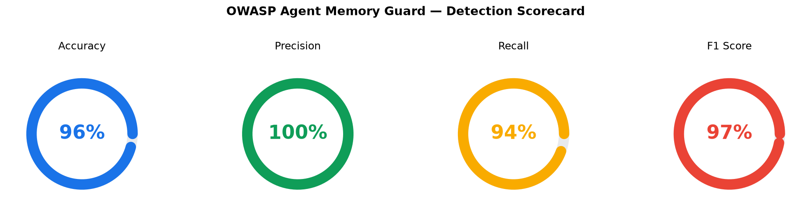
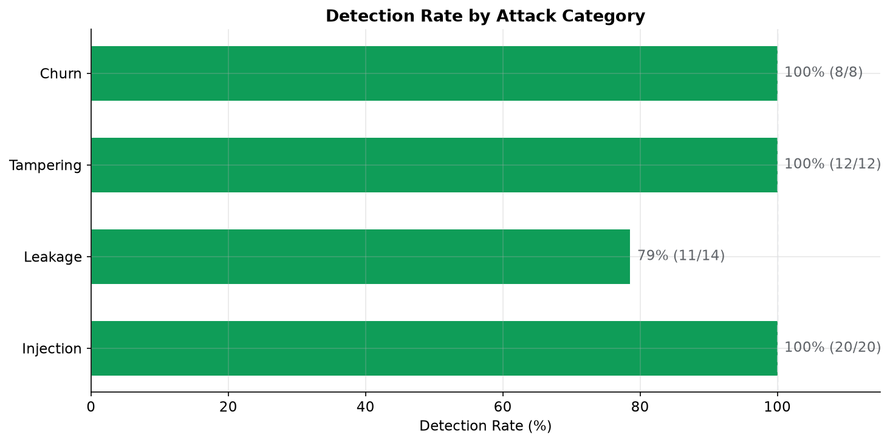
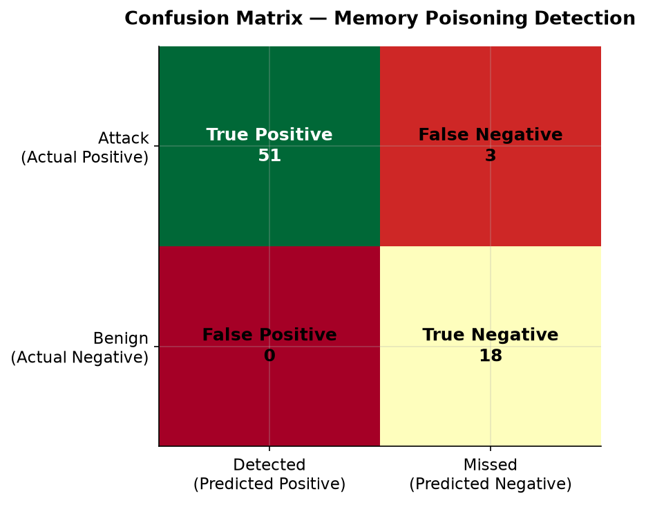
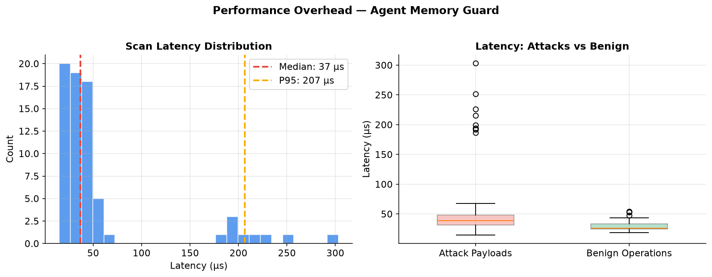
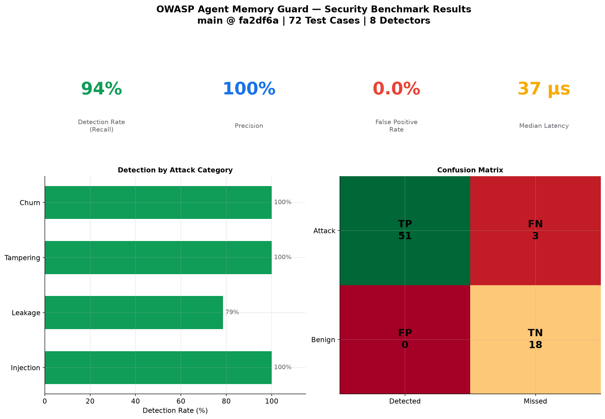

# OWASP Agent Memory Guard — Security Benchmark Report

**Version**: main @ fa2df6a
**Test Cases**: 72
**Date**: 2026-11-02
**Python**: 3.13.5

---

## Executive Summary

With the `Default detectors + memory_persistence_injection` configuration under the benchmark's custom policy, Agent Memory Guard detected **94.4%** of attack cases with **100.0% precision** across 72 labeled test cases; median corpus-write latency was **37 µs** in this local run.

| Metric | Value |
|--------|-------|
| **Accuracy** | 95.8% |
| **Precision** | 100.0% |
| **Recall (Detection Rate)** | 94.4% |
| **F1 Score** | 0.971 |
| **False Positive Rate** | 0.0% |
| **False Negative Rate** | 5.6% |
| **True Positives (TP)** | 51 |
| **True Negatives (TN)** | 18 |
| **False Positives (FP)** | 0 |
| **False Negatives (FN)** | 3 |

### Confusion Matrix

| Actual \ Predicted | Detected (Positive) | Allowed (Negative) |
|---|---|---|
| **Attack (Actual Positive)** | True Positive (TP): **51** | False Negative (FN): **3** |
| **Benign (Actual Negative)** | False Positive (FP): **0** | True Negative (TN): **18** |

---

## Detection by Attack Category

| Category | Detection Rate | Detected | Missed | Total |
|----------|---------------|----------|--------|-------|
| Injection | 100% | 20 | 0 | 20 |
| Leakage | 79% | 11 | 3 | 14 |
| Tampering | 100% | 12 | 0 | 12 |
| Churn | 100% | 8 | 0 | 8 |

### False Positive Analysis (Benign Operations)

| Metric | Value |
|--------|-------|
| Benign samples tested | 18 |
| Correctly allowed (TN) | 18 |
| Incorrectly flagged (FP) | 0 |
| False positive rate | 0.0% |

---

## Configuration Coverage

Both configurations use the benchmark's custom `Policy` (`default_action=ALLOW`), including protected keys (`identity.*`, `system.*`, `agent.goal`, `agent.capabilities`, `security.*`), immutable `identity.user_id`, and block/quarantine rules. `Default detectors` loads the default detector suite; `Default detectors + memory_persistence_injection` adds the opt-in `memory_persistence_injection` detector. Both run the identical 72-case corpus (54 attacks, 18 benign controls); only the detector set differs.

| Configuration | Detectors | Recall | Precision | FP rate | Missed |
|---------------|-----------|--------|-----------|---------|--------|
| Default detectors | 7 | 85.2% | 100.0% | 0.0% | 8 |
| Default detectors + memory_persistence_injection | 8 | 94.4% | 100.0% | 0.0% | 3 |

**Opt-in detector added in the second configuration**: `memory_persistence_injection`

Per-category detection, `Default detectors` vs `Default detectors + memory_persistence_injection`:

| Category | Default detectors | Default detectors + memory_persistence_injection |
|----------|-------------------|--------------------------------------------------|
| Injection | 15/20 | 20/20 |
| Leakage | 11/14 | 11/14 |
| Tampering | 12/12 | 12/12 |
| Churn | 8/8 | 8/8 |

---

## Performance Overhead

| Metric | Value |
|--------|-------|
| **Median latency** | 37 µs |
| **Mean latency** | 58 µs |
| **P95 latency** | 207 µs |
| **P99 latency** | 267 µs |
| **Max latency** | 303 µs |

This local, synthetic measurement is not a general latency guarantee for production agent operations.

### MemoryGuard Overhead Baseline (Guarded vs Bare InMemoryStore)

Overhead is calculated as guarded latency minus unguarded bare InMemoryStore latency across payload sizes. Measurements are local and synthetic. The performance payloads are `"x" * n` and are not crafted to match the content detectors; the `1-rule` and `10-rule` policies therefore differ in rule-evaluation cost, not in detection outcome.

| Policy | Payload Size | Operation | Unguarded Bare Store (µs) | Guarded MemoryGuard (µs) | Guard Overhead (µs) |
|--------|--------------|-----------|---------------------------|--------------------------|---------------------|
| 1-rule | 100b | read | 0.1 | 17.2 | 17.1 |
| 1-rule | 100b | write | 0.1 | 18.4 | 18.3 |
| 1-rule | 1kb | read | 0.1 | 137.5 | 137.4 |
| 1-rule | 1kb | write | 0.1 | 144.6 | 144.5 |
| 1-rule | 10kb | read | 0.1 | 1366.1 | 1366.0 |
| 1-rule | 10kb | write | 0.1 | 1364.6 | 1364.5 |
| 1-rule | 100kb | read | 0.1 | 13803.9 | 13803.8 |
| 1-rule | 100kb | write | 0.1 | 13813.3 | 13813.2 |
| 10-rule | 100b | read | 0.1 | 17.2 | 17.1 |
| 10-rule | 100b | write | 0.1 | 19.4 | 19.3 |
| 10-rule | 1kb | read | 0.1 | 142.4 | 142.3 |
| 10-rule | 1kb | write | 0.1 | 144.0 | 143.9 |
| 10-rule | 10kb | read | 0.1 | 1367.5 | 1367.5 |
| 10-rule | 10kb | write | 0.1 | 1354.5 | 1354.4 |
| 10-rule | 100kb | read | 0.1 | 13788.6 | 13788.5 |
| 10-rule | 100kb | write | 0.1 | 13861.2 | 13861.2 |

### Store Backend Comparison: InMemoryStore vs RedisMemoryStore (fakeredis, in-process)

**Redis Backend Status**: RedisMemoryStore (fakeredis, in-process)

Limitations: RedisMemoryStore measurements use fakeredis (in-process emulation, no network I/O). These synthetic local numbers do not represent network latency or a real Redis server.

| Policy | Size | Operation | InMemoryStore (µs) | RedisMemoryStore (fakeredis, in-process) (µs) | fakeredis / in-memory ratio (synthetic in-process, no network) |
|--------|------|-----------|--------------------|-----------------------------------------------|----------------------------------------------------------------|
| 1-rule | 100b | read | 17.2 | 97.2 | 5.6x |
| 1-rule | 100b | write | 18.4 | 52.2 | 2.8x |
| 1-rule | 100b | snapshot | 9.3 | 95.4 | 10.3x |
| 1-rule | 100b | rollback | 5.7 | 110.5 | 19.3x |
| 1-rule | 1kb | read | 137.5 | 219.0 | 1.6x |
| 1-rule | 1kb | write | 144.6 | 173.5 | 1.2x |
| 1-rule | 1kb | snapshot | 11.8 | 97.5 | 8.2x |
| 1-rule | 1kb | rollback | 5.8 | 117.7 | 20.3x |
| 1-rule | 10kb | read | 1366.1 | 1467.8 | 1.1x |
| 1-rule | 10kb | write | 1364.6 | 1431.7 | 1.0x |
| 1-rule | 10kb | snapshot | 35.8 | 133.3 | 3.7x |
| 1-rule | 10kb | rollback | 5.8 | 131.0 | 22.7x |
| 1-rule | 100kb | read | 13803.9 | 14171.3 | 1.0x |
| 1-rule | 100kb | write | 13813.3 | 14155.5 | 1.0x |
| 1-rule | 100kb | snapshot | 272.5 | 487.5 | 1.8x |
| 1-rule | 100kb | rollback | 5.9 | 338.5 | 57.4x |
| 10-rule | 100b | read | 17.2 | 94.9 | 5.5x |
| 10-rule | 100b | write | 19.4 | 49.8 | 2.6x |
| 10-rule | 100b | snapshot | 9.6 | 91.7 | 9.6x |
| 10-rule | 100b | rollback | 5.8 | 107.1 | 18.5x |
| 10-rule | 1kb | read | 142.4 | 223.0 | 1.6x |
| 10-rule | 1kb | write | 144.0 | 174.2 | 1.2x |
| 10-rule | 1kb | snapshot | 12.2 | 96.7 | 8.0x |
| 10-rule | 1kb | rollback | 5.8 | 114.3 | 19.5x |
| 10-rule | 10kb | read | 1367.5 | 1499.5 | 1.1x |
| 10-rule | 10kb | write | 1354.5 | 1409.1 | 1.0x |
| 10-rule | 10kb | snapshot | 35.6 | 134.3 | 3.8x |
| 10-rule | 10kb | rollback | 5.8 | 141.0 | 24.4x |
| 10-rule | 100kb | read | 13788.6 | 14135.8 | 1.0x |
| 10-rule | 100kb | write | 13861.2 | 14136.5 | 1.0x |
| 10-rule | 100kb | snapshot | 280.0 | 470.1 | 1.7x |
| 10-rule | 100kb | rollback | 6.3 | 335.5 | 53.5x |

---

## Visualizations











---

## Methodology

- **Guard Configuration**: the benchmark's custom `Policy` (`default_action=ALLOW`), including protected keys (`identity.*`, `system.*`, `agent.goal`, `agent.capabilities`, `security.*`), immutable `identity.user_id`, and block/quarantine rules. Both benchmark configurations use this policy.
- **Attack Corpus**: exactly 54 attack payloads across injection, leakage, tampering, and churn, alongside 18 benign controls (72 test cases total)
- **Categories Tested**: Injection (20), Leakage (14), Tampering (12), Churn (8), Benign (18)
- **Configurations Tested**:
  - **Default detectors (7 detectors)**: `PromptInjectionDetector`, `SensitiveDataDetector`, `SizeAnomalyDetector`, `RapidChangeDetector`, `ProtectedKeyDetector`, `CrossTaskContaminationDetector`, `SelfReinforcementDetector`
  - **Default detectors + memory_persistence_injection (8 detectors)**: the default suite plus opt-in `MemoryPersistenceInjectionDetector` (`memory_persistence_injection`)
- **Performance Policies**: `1-rule` contains one `prompt_injection` rule; `10-rule` contains ten rules over the default detector names, including key-scoped rules. Performance payloads are `"x" * n` and do not target content-detector patterns.
- **Measurement**: Each test case runs on a fresh `MemoryGuard` instance to avoid state leakage
- **Latency**: Measured via `time.perf_counter_ns()` (wall-clock, includes all detector processing)
- **Overhead Baseline**: Measured against unguarded bare `InMemoryStore` operations per payload size (overhead = guarded latency − unguarded latency)
- **Backend Emulation**: Redis tests use in-process `fakeredis` emulation without network round-trips

---

## How to Reproduce

```bash
cd /path/to/www-project-agent-memory-guard
pip install -e ".[dev]"
pip install matplotlib numpy fakeredis
python benchmarks/security_benchmark.py
```

Results are saved to `benchmarks/results/`.
